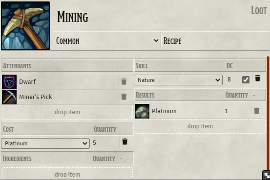

# Changelog

## 4.9.0
- recipe macro can run at different moments
  - write one object with a function per moment: `start`, `inputChosen(component, preview)`, `resultChosen(component, preview)`, `finish(success)`
  - `inputChosen` / `resultChosen` run for every chosen cost and result before anything is checked or paid, so quantities and money can still be changed (e.g. half the price of the chosen result)
  - the crafting window shows these changes as a preview
  - the old form (plain code) keeps running when the crafting starts
  - the example in the recipe sheet shows the new form
- new compendium "D&D 2024 Tool Recipes" (dnd5e only)
  - one recipe per tool with everything the tool can craft by the 2024 rules, choose the item when crafting
  - the raw materials cost half the price of the chosen item (recipe macro)
  - proficiency with the tool is needed
  - uses the items of the Player's Handbook when it is active, otherwise the free dnd5e equipment (SRD 5.2)
- fix: money was paid but not given back when a recipe macro failed

## 4.8.4
- redesign recipe sheet
  - recipes open their own sheet, independent of the system's item sheet
  - recipes are recognized by their flag, whatever item type the system uses
  - "System sheet" button opens the system's sheet for price, weight, description …
  - another sheet can still be chosen per item in Foundry's sheet configuration
  - follows Foundry's dark and light mode
  - header with image, name and folder; the folder is edited in place
  - foldable sections instead of tabs: instruction, required, cost, results, checks, macro
    - empty instruction and macro start folded
  - arrow from cost to results, like in the crafting window
  - "one of" alternatives are shown explicitly, every entry has its own "or" drop zone
  - money can be added in every drop zone and its currency changed in the line
  - "crafted" flag as a hammer next to the item name
  - checks as numbered steps with alternative checks, test type select with icons
  - example for the macro that works in every system
  - read only view for players
- fix: adding steps or alternative checks could pick a wrong id (e.g. after 9 steps)

## 4.8.3
- redesign crafting chat message
  - adapts to dark / light mode and the system's chat style
  - outcome, checks, results, used items and tools at a glance; the reason when it fails
  - "draggable chat result" works on the new message too

## 4.8.2
- crafting compendium: open decisions are made inline instead of in a popup
  - "choose one" and "any of" are highlighted when crafting while still undecided
  - "any of" lists the matching items inline when clicked, with have / need
  - a made choice can be undone
- clearer have / need display
- remove unused pictures
## 4.8.1
- redesign crafting tab in actor sheets
  - adapts to the colors and fonts of each system's sheet
  - progress of checks, next check and roll/finish button per crafting
  - collapsible folders and details
## 4.8.0
- redesign crafting compendium
## 4.7.0
- foundry v14 support
  - replace deprecated deletion keys, globals and hooks
  - minimum foundry version is now 13
- build with esbuild and pnpm instead of gulp, releases via github workflow
## 4.6.2
- currency-component have a dropdown on edit.
## 4.6.1
- fix chatLog feature to drag items from it.
## 4.6.0
- start support for currency as virtual item.
  - currency can now be used optional
  - currency can now be used as a result of the recipe.
## 4.5.2
- fix tab for pf1e
- remove unsupported v14 handlebar modules
## 4.5.1
- readd dnd5e container support
## 4.5.0
- add support for macro output
## 4.4.5
- fix tab toggle in some systems e.g. pf2e
## 4.4.4
- fix beavers container in some systems
  - when adding or removing items to containers those are not hidden or disabled in itemDirectory instantly accordingly.
## 4.4.3
- fix recipe compendium
  - add container !!
## 4.4.2
- fix beavers item button
  - add container
  - enable disable will repaint itemDirectory accordingly.
## 4.4.1
- fix deletion of container
  - handle content of those container gracefully.
  - periodically check for abandoned containers and release its content.
## 4.4.0
- add experimental container
## 4.3.3
- fix createBeaversItem button only appears when user has permission to create items.
- fix creating Items with BeaverIteamDialog now opens the item sheet.
## 4.3.2
- possibility to enable a seperate CreateBeaver`sItem dialog button.
## 4.3.1
- fix recipe compendium
  - header style
  - localisation
## 4.3.0
- feat: add searchbar for recipe compendium: [#146](https://github.com/AngryBeaver/beavers-crafting/issues/146)
## 4.2.1
- fix default value for Tests that has not been stored.
## 4.2.0
- enable anyOf for result it will currently use all items of the world regardless of ownership. It will currently not lookup compendiums.
## 4.1.7
- fix ownership of items. At somepoint ownership has been reworked by foundry now i get all items for game.items not only those the user can see.
## 4.1.6
- fix create item for dnd5e v5.2.x thx to [Corbeaux12](https://github.com/Corbeaux12)
## 4.1.5
- add fr language thx to [Michel](https://github.com/jehan-michel)
## 4.1.4
- fix consume on Error
- add resizeable to item sheets v2
## 4.1.3
- fix tidy 5e actor tab
- fix click to show item preview
## 4.1.2
- fix a bug with drop-area for dnd applicationV1 system
## 4.1.1
- fix a bug with missing hbs file thanks to Matt/WookieeChan to point that out.
## 4.1.0
- re-style
- add color scheme
- fix drop-area for some applicationV1 systems
## 4.0.15
- more fixes for ApplicationV2 tested on wfrp4e
## 4.0.14
- fix for ApplicationV2 tested on dnd5 v5
- fixed problmen with more then 10 items.~~
## 4.0.13
- remove dnd5.preuseItem (is deprecated, system specific and there is no replacement of that sort)
- fix adding bastion features.
## 4.0.12
- fix recipeCompendium for foundry v13.338
## 4.0.11
- fix recipe for some systems using formApplication
## 4.0.10
- fix for systems not using formApplication as itemSheet.
  - fix updating changes for selectBoxes in test section.
  - fix removing test sections
  - fix removing currency,
  - fix updating changes for input boxes just created e.g. currency or tests
  - fix checkbox for consume tests
  - fix recipe item macro button reloading the page
  - fix progress recipes on actor
- ui changes
  - remove submit button for recipe macros
  - use full size for macro textarea
  - fix text-area color to be also white
  - dnd5e fix remove borders for recipe creation
  - a5e fix test hits input not visible
## 4.0.9
- ui-stuff
  - crafting-app dimensions from 700 to 900 width
  - crafting-app sections default to min-width:200px -> 300px.
  - store crafting-app dimensions per client
  - fix ui bug crafting-details on actor.
- v14 compatible changes
## 4.0.8
- v13 ready 
## 4.0.7
- fix consume money on failed check
## 4.0.6
- fix ToolTest migration
## 4.0.5
- migration is now an asynchronous Task that will not break the module.
## 4.0.4
- translated to Brazilian Portuguese by [Andersants](https://github.com/Andersants)
## 4.0.3
- remove potential bug with migrate scripts.
- fix recipeSheet for systems without Formapplication e.g. a5e
## 4.0.1 + 4.0.2
- fix compatibility warnings for v14
## 4.0.0
- rework tests
  - tests are now modular
  - different game systems can have their own tests
  - dev's could register additional tests
⚠️ breaking
  - there is a migration script transform any existing recipe to the new structure once
  - you can start this process again manually.
````javascript
game["beavers-crafting"].migrateRecipeTestsToBeaversTests();
````
## 3.6.0
- add [copy results from Chatlog](https://github.com/AngryBeaver/beavers-crafting/issues/143)
  - configurable via Settings
## 3.5.5
- fix compatibility to pf1
- removed scrollbars when not needed
## 3.5.4
- add setup helper capture target window
- fix recommend ids
## 3.5.3
- v12 ready
- tidy5e compatiblity
## 3.5.2
- fix quick fix for legacy dnd5e < 3.x
## 3.5.1
- quick fix dnd5 create Item
## 3.5.0
- add fallout 2d20 support
- allow AnyOf in required-section
## 3.4.4
- Add Hook beavers-crafting.start
## 3.4.3
- add basic support for a5e in the most evil way (extending svelte with jquery)
## 3.4.2
- fix anyOf (broken macros can hinder rendering of item)
- feature: advanced macros now access the complete recipe 
  - this should allow dynamic dcs by manipulating the recipe.test during runtime.
- prepare recipeSheet and anyOfSheet for systems using sheets with none standard Applications
  - A5E does not have anything usefull within parameter html or data.
- add dnd 3.5 support
## 3.4.1
- configurable TabName/TabIcon
  - Beavers-Crafting is no longer only for Crafting, it is and can be used for various other things like: quest Progress, Tech Trees, Downtime Activities, ...
- remove deprecated crafting header icon.
- rework readme
## 3.4.x v11+
- start v11+ branch
## 3.3.x crafted flag
## 3.3.3
- start v10 branch (eol)
## 3.3.2
- add tidy5e support
- improve compatiblity to other systems 
## 3.3.1 
- replace diamond with tools icon
## 3.3.0
- add support for recipes that are based on crafted items.
- remove beavers-crafting.status flag 
- add beavers-crafting.isCrafted flag
## 3.2.x simple or
## 3.2.4
- fix anyOf: has not used bsa-x implementation was broken on some systems.
## 3.2.3
- some reported module incompatibility fixes
## 3.2.2
- automatically fix broken tools (dnd5e)
- add flag to created or updated items
- fix broken anyOf precast status
- fix recipes returning results that are based on items that do not have quantity
## 3.2.1
- recipe edit quantity
## 3.2.0
- fix consistent name of attendants as required in ui.
- add Settings to disable actor types that should not have a crafting tab.
- add simple or
- simple or ui selection
- anyOf ui selection
## 3.1.x folders
## 3.1.7
- fix anyOf allow dropping for players
## 3.1.6 v11 fixes
- fix chat message
- fix close RecipeCompendium
## 3.1.5
- handle null rolls
- systeminterface return type of rolls maybe null (if aborted)
- fix drag and drop in recipesheet for some systems.
## 3.1.3
- fix always revert currency on failed crafts.
- fix on enter open crafting tab.
- css adaption to overwrite swade incompatibility stlyes.
## 3.1.2
- fix collision to better roll tables
## 3.1.1
- css bug in some browsers
## 3.1.0
- add folder structure
- ui redesign beavers recipe compendium add responsiveness
- add precast currency
- add hit progression text
- fix type selection does not change type-sub selection.
- ui redesign recipe configuration
- add instruction text
- fix rescale create Item
- fix more then two tests
- ui redesign crafting tab on actor
- ui redesign chatMessage

## 3.0.x progress tracking and multiple tests
## 3.0.2 
- fix consume on failed check
- fix restore consumed items

## 3.0.1 v11 support
- enables support for v11

## 3.0.0 progress tracking and multiple tests
- This module now enables tracking of your progress through a series of tests.
- You can now specify a tool roll test in dnd5e.

⚠️breaking changes
- recipe.skill becomes recipe.tests.
````javascript
game["beavers-crafting"].migrateRecipeSkillToTests();
````
- recipe.tools are migrated to recipe.attendants
````javascript
game["beavers-crafting"].migrateDeprecateTools();
````
After installing, it first all your recipes will get migrated automatically.
If you have created compendiums with recipes you need to import them then run the migrationscripts manually and export them again.
- useTool is now removed was deprecated since 0.7.x and is now integrated into tests.

## 2.3.x feature system independent
## 2.3.5 anyOf bugs
fixed: reacitvate Setting for disable actor header link "📜Recipes"
## 2.3.4 anyOf bugs
fixed: dropping anyOf in recipes no longer is detected as anyOf
## 2.3.3 anyOf bugs
fixed: dropping items on an anyOf ingredient does no longer work.

fixed: evaluated anyOf items are incorrectly detected as non matching to the actor.
## 2.3.2 fix tools
fixed: using tools was completely broken.
(jfi: tools are deprecated in favour of attendants dnd5e only)
## 2.3.1 bug pulling items from compendium
fixed: when dropping items from compendium they no longer have an itemType thus they will not be detected correctly as equal to any item on actor.

fixed: when one recipe refers to an item no longer in this world you could not open the compendium browser
## 2.3.0 feature system independent

⚠️This module now depends on other modules to work, you need to enable them ⚠️

This module can now run on multiple systems. 
It is implemented against [Beaver's System Interface](https://github.com/AngryBeaver/beavers-system-interface),
so this module does not have any code to run on your system.

In order to make this module work on your system, all you need is a tiny bsa-x implementation that maps the interface to your system.
You can write your own or use [existing once](https://github.com/AngryBeaver/beavers-system-interface/wiki/BSA-x-links) others have written.
I start of providing one for [dnd5e](https://github.com/AngryBeaver/bsa-dnd5e) and one for [pf2e](https://github.com/AngryBeaver/bsa-pf2e).

Those adaptions are pretty simple and small but needs some insights about the system. 
So my hope is those playing in a system knowing it can write their own adaptions without me who has no idea about that system.
If not you at least now have this module in pf2e as well.

## 2.2.x feature: Time To Craft
### 2.2.2 workaround for ready set roll
This fix should work for the current version of ready set roll 1.3.14.
Might break at any other version ! a request for more robust interface has been made:
### 2.2.1 fix worldtime is zero
Crafting does not become success when the worldtime is zero.
Sadly I could not automatically fix old crafting processes without breaking unfinished crafting processes.
### 2.2.0 feature: Time To Craft
Crafting becomes a process that you start when clicking on the RecipeCompendium.
The crafting process starts by consuming all resources and fireing up the advanced macro but without granting the results.
When you decide the time to craft is ready you can process the crafting by clicking on the status of the process.
Now the skill check if any is executed and the crafting might end in success or fail. You will get your results and locked resources are freed up if the crafting process allows so.

You can configure the timeToCraft behaviour in the settings section.
Interaction is default it will start the process and waits until you finish the process with your action.
Instantly will switch back to previous mode. you can craft with one click instantly.

#### Time To Craft vs world time automation
E.g. you start the recipe and when the worldtime is advanced by an amount given in the recipe, the crafting completes.

In this first draft I decided against this! As crafting is a downtime activity and passing time does not automatically mean you spend the time on crafting, you might sleep or run for you live from monsters, who knows.


## 2.1.x feature: Crafting tab on actor
### 2.1.2 fix: dnd5e dependent money exchange.
add: system independent money exchange, any system may be implement against an interface.
add: dnd5e exchange implementation.

### 2.1.1 fix: referenced ingredients
fixed: when you do not have given ingredient crafting required the ingredient reference to be valid.

### 2.1.0 feature: Crafting tab on actor
Crafting is now a tab on ActorSheet that shows the history of your crafting processes.
Crafting process can now be serialized and deserialized and thus be stored next to the actor initiating the craft process.
This is the core implementation that will allow future features like time to craft and crafting as downtime process with multiple checks.

## 2.0.x breaking change: extract potions module
### 2.0.1 fix: rerender Recipe Compendium
fixed: when the recipes button is pressed while the window is somewhere open the window will does not popup to front and also does render blank content.
### 2.0.0 breaking change: extract potions module
The example components have moved to an extra module. 
#### why
- potions are dnd5e only and needed a legal term from wizzards of the costs.
- potions have a lot of dnd5e module dependencies and beavers-crafting is currently developed in a direction to maybe allow another system at somepoint.
- some people just wanted potions content without crafting or crafting without potions.
#### breaking:
Previous imported recipes won't work anymore as the resource has moved.

-> You need to import the latest recipse from Beaver's Potions. 

Own recipes that produc the example potions referenced from compendium will not work anymore.

-> delete old potion in recipe and reference new compendium.


## 1.0.x macros
### 1.0.0 feature macros
You can now use macros to customize your recipes further see see [RecipeMacro](https://github.com/AngryBeaver/beavers-crafting/blob/main/macros.md)
You also will find a handful examples solving some user feature requests. 
### 1.0.0 refactored stable
As internal Data is now public available via macro this needed to get refactored in an easy to use and possibly on most parts stable interface leading to version 1.0.0.
Plz note that the internal code is massive refactored basically rewritten hopefully i covered everything to work the same as before, but keep an eye out maybe i missed something.

Hopefully the only difference for the users are 
- chat is now displaying negative quantity on consumed components.
- skillCheck is done regardless of failed components -> because macro can lately decide to fix fails or fail success runs.

## 0.7.x attendants
### 0.7.1 update: identity check
!Breaking Change!
This module intended to match items by a dnd5 core flag "source". Two objects are matching if they have the same name and are from the same source.
Sadly this was broken in various ways. e.g. Using attendants with class, feature or similar imported von dnd-beyond did not work on recipes.

Therefor I changed the identity check of this module to match items when they have the same itemType and name.
A migration script is running the first time you install 0.7.1. fixing all recipes not in compendiums. If you still have broken recipes or you just imported broken recipes from compendium you can fix those with:
````javascript
game['beavers-crafting'].itemTypeMigration()
````
### 0.7.1 update: weaken reference
Recipes do not store the complete Item but a reduced view called Component that has all basic information needed for recipes as well as a reference the uuid.
UUIDs are not unique to items but to the instance. So each copy has a new uuid making it hard to create recipes that can be transfered to other worlds as you also need to transfer the referenced items with the exact same uuid.
Only uuids within compendiums are unique across worlds. That is why I recommend using compendiums in the recipe creation process.

! As of 0.7.1 items no longer need to match the source so you may decouple your recipe from your referenced items.

Components do now also store the itemType for comparing Components to Items. Old Components do not have this property.
You can fix your existing recipes (not compendium recipes)
````javascript
game['beavers-crafting'].itemTypeMigration()
````
Meaning you can copy your recipes to another world witch does not have the original sources your recipes needed, but instead any instance with the same name and type.
This does only work for Attendants and Ingredients that are not of type "AnyOf". (may come later)
For results you still need the original item as this is copied over to the actor. (complete items are not stored but components)

Keep in mind that you can not click and show up the item descriptor of Ingredients, Attendants that are not also imported into the new world. You can disable this setting: "display ingredient sheet"
### 0.7.1 feature: own recipes
Your RecipeCompendium now contains also the recipes the user owns e.g. are in his inventar. You can also filter for own recipes only.

### 0.7.0 feature optional attendants
You now are able to create recipes with attendance that are items, features, tools or classes that are required in the craft process but not consumed.




This enables completly diffrent kinds of recipes like e.g. mining or gathering
that requires certain items like sickle or backgrounds like Farmer etc...

### 0.7.0 feature add abilities as skillCheck


### 0.7.0 bug: "missing tools check when ingredients are not available" fixed
### 0.7.0 bug: "consume costs on failed check while recipe requirements are not fullfilled" fixed
### 0.7.0 bug: "roll skill with insufficient requirements" fixed

## 0.6.x customized AnyOf
### feature customized AnyOf ingredient
You now are able to customize recipes that uses anyOf Ingredients,
and by doing so define what specific ingredients you want to use for this recipe.


- drag and drop an ingredient (e.g. from your inventar) to "anyOf" ingredient within your recipeCompendium.
- it will automatically check if that new ingredient is available in that quantity.
- it will stack same (identity same!) ingredients.
- when you reselect the recipe it will remove your customization and start over with anyOf Items again.

### bug: "selection of recipe is not shown as selected." fixed
### bug: "click ingredient or result will only work on first recipe" fixed

## 0.5.x feature tool
you now can use tools, if you do not have the tool you dont get a check you simple fail and your ingredients won't vanish.
## 0.4.x feature compendiums,
you now can use items directly from compendium,
module comes with 4 compendiums ingredients,rolltables,potions and recipes
## 0.3.x feature add initial anyOf ingredient
you now can have anyOf ingredients
breaking change 0.2.x -> 0.3.x
## 0.2.x feature add rollTable result
you now can produce a random Potion.
breaking change 0.1.x -> 0.2.x
